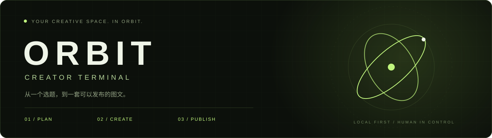
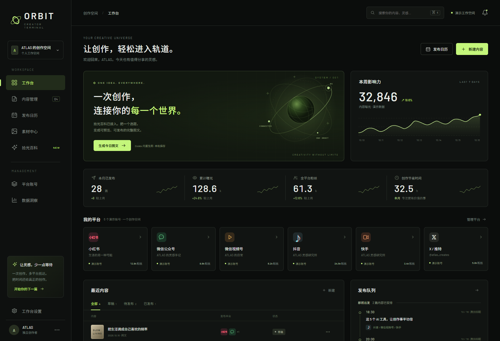
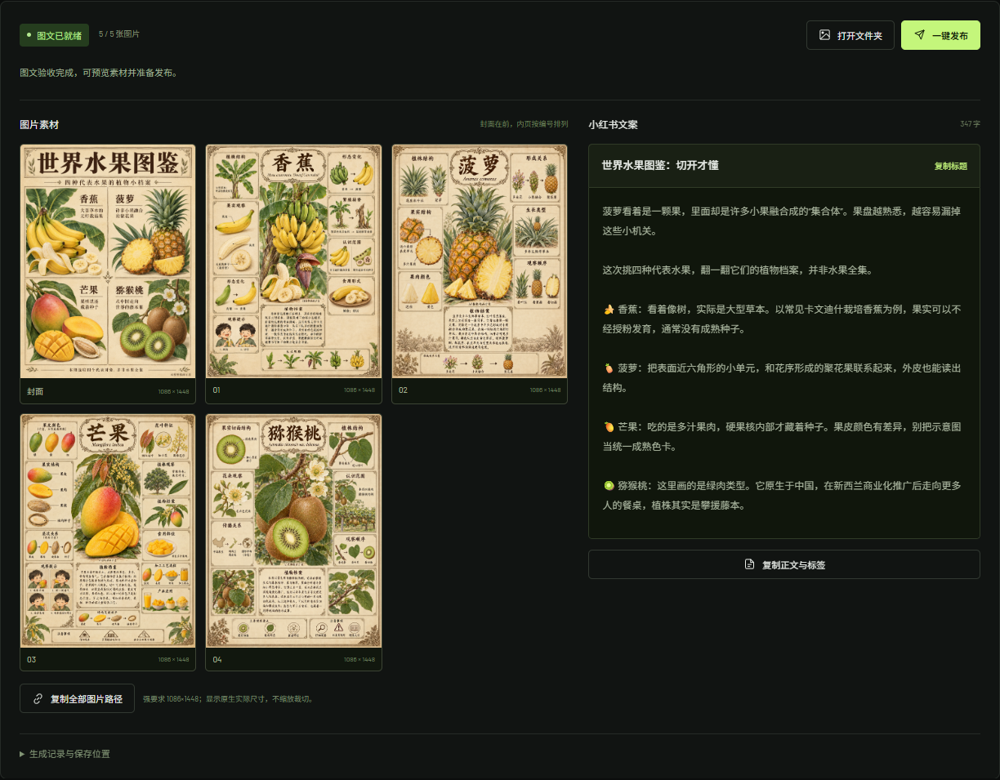
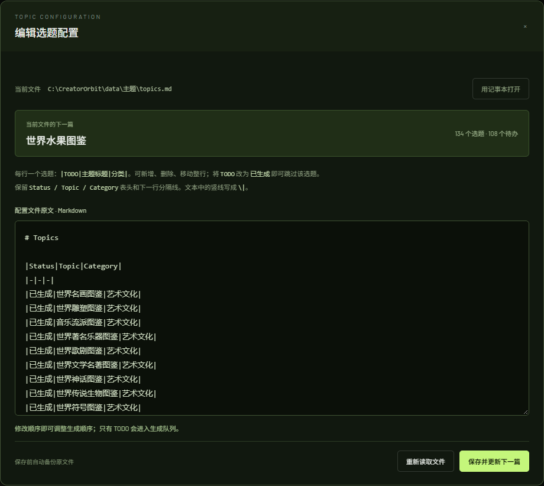
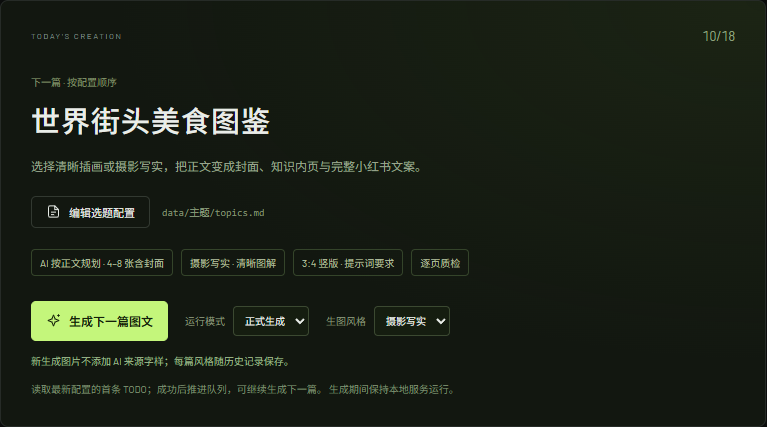
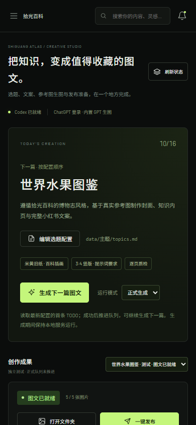

<div align="center">



# Creator Orbit

**让创作更专注，让发布更轻松。**

一个运行在本机的 AI 自媒体创作工作台。<br/>
管理选题、生成图文、整理素材，把重复的发布准备交给 ORBIT。

   

[界面预览](#界面预览) · [快速开始](#快速开始) · [创作流程](#创作流程) · [选题配置](#选题配置) · [开发与验证](#开发与验证)

</div>

---

## 为什么做 ORBIT

自媒体创作里，有很多时间花在内容之外：找下一个选题、整理图片、打开发布页面，再来回复制标题、正文和文件路径。

ORBIT 把这些步骤放进一个深色、简约的工作台。当前已打通 **小红书「拾光百科」的本机创作与发布准备流程**：用已登录的 Codex 核实来源、生成文案和图片，完成验收后，打开发布所需的页面与文件。

> **当前能力**：小红书图文生成与发布准备已接入真实流程；微信公众号、视频号、抖音、快手、X 的管理界面目前是演示。上传和最终发布仍由你在平台页面确认。

## 界面预览

### 01 / 创作总览

平台矩阵、内容草稿、发布日历与素材入口，集中在一个工作台。



<sub>总览中的账号、粉丝数、数据指标和初始内容为演示数据。</sub>

### 02 / 从选题到完整图文

封面、内页、文案与原生尺寸一起预览。只有完整验收通过，才开放发布准备。



<sub>图中为实际生成的「世界水果图鉴」测试成果：1 张封面、4 张内页及配套文案；5 张图片原生尺寸均为 1086 × 1448。测试模式不推进正式选题队列。</sub>

### 03 / 下一篇，由你决定

直接编辑正在使用的 Markdown 配置，调整标题、分类、状态和顺序。保存后，下一篇立即刷新。



<sub>截图来自本机运行界面；配置文件路径仅在截图中做了展示脱敏。</sub>

### 04 / 风格可选，创作可回看

生成前选择 **清晰插画** 或 **摄影写实**，工作台记住上次选择。新图不添加 AI 来源字样；已有图片保留原样。



历史记录支持搜索、筛选、查看原图与文案，以及一键转发准备。每篇保留自己的风格与页数。


<sub>截图为本机真实记录。新增两篇测试分别生成 6 张与 7 张图，全部原生尺寸 1086×1448；图内标记按用户选择保留，新规则仅影响后续任务。</sub>

<details>
<summary><strong>查看手机宽度下的布局</strong></summary>
<br/>
<div align="center">

</div>

手机截图展示响应式布局。当前生成与桌面发布助手仍运行在 Windows 本机，服务默认只接受本机访问。

</details>

## 核心功能

| 功能 | 你可以做什么 |
| :--- | :--- |
| **选题队列** | 读取未被任务占用的首条 TODO，也可单独选择本次选题；完成后只更新对应行 |
| **并行创作** | 同时运行最多 3 篇，每篇独立选题、风格、复审开关、素材与进度；单篇停止或恢复 |
| **Codex 内置生成** | 使用 ChatGPT 登录态运行 Codex，生成文案和真实 PNG；无需配置图像 API Key |
| **按正文规划配图** | Codex 根据正文决定 1–11 张总图，每张内容图只介绍一个独立对象；十大流派各一页，加封面共 11 张 |
| **专业解读文案** | 先写完整底稿，再用适合小红书阅读的短段落讲清事实、原因与影响；发布前复读并记录正文依据，避免目录式概括 |
| **Codex 内容复审** | 可开关的独立复审会话：逐张看图、核实事实、修正文案或错误图页，保留备份；未通过则阻止发布准备 |
| **发布字数检查** | 普通图文标题最多 20 字、正文含标签最多 1000 字，显示当前计数，超限先精简再发布 |
| **参考图与质检** | 使用 Skill 附带参考图，保留提示词、来源、原图哈希与逐页检查记录 |
| **成果预览** | 查看图片、放大细节、读取标题正文、确认实际尺寸 |
| **历史生成记录** | 按主题、标题、日期查找，筛选正式/测试成果；查看图文或再次一键转发准备 |
| **两种生图风格** | 生成前自由选择「清晰插画」或「摄影写实」，记住上次选择；新图不添加 AI 来源字样 |
| **清晰度与原图** | 统一加入干净通透、自然纹理与清晰边缘要求；支持 100% 查看及保存原始 PNG |
| **发布准备** | 打开小红书创作页、素材目录、文案和封面；复制全部图片路径 |
| **恢复与备份** | 中断后保留成果继续，或暂存到作品库后换题创作；配置保存前备份，外部修改冲突时保留草稿 |
| **隔离测试** | 使用独立队列副本验证流程，不推进正式选题进度 |
| **内容工作台** | 浏览器内草稿编辑、搜索筛选、日历、JSON 导出及多平台 UI 演示 |

### 平台支持范围

| 平台 | 当前状态 |
| :--- | :--- |
| 小红书 | **真实可用**：拾光百科图文生成、验收、本机发布准备 |
| 微信公众号 / 微信视频号 | 管理与内容界面演示 |
| 抖音 / 快手 | 管理与内容界面演示 |
| X（Twitter） | 管理与内容界面演示 |

## 快速开始

### 环境准备

- **Windows 10 / 11**：Explorer、记事本和系统剪贴板用于发布准备。
- **Node.js 18+**：运行本地服务；本项目已在 Node.js 24 上验证。
- **Python 3.10+ 与 Pillow**：读取队列、校验 PNG 和执行 Skill 工作流。
- **Codex CLI**：使用 **ChatGPT 账号登录**，具备内置 `image_gen` 能力及已配置的 Windows 沙箱环境。

内置生图使用登录账户的 Codex 额度，受工具可用性、网络和额度限制。项目不通过外部图像 API 生成图片。

### 安装与启动

```powershell
git clone https://github.com/XiaoyeCodes/creator-orbit.git
cd creator-orbit

# 安装图片校验依赖
python -m pip install Pillow

# 如果 Codex 已加入 PATH，可检查登录状态
codex login status
# 尚未登录时运行：codex login

# 启动本地工作台
npm start
```

打开 **[http://127.0.0.1:4173/#atlas](http://127.0.0.1:4173/#atlas)**。

项目没有 npm 运行时依赖，无需先执行 `npm install`。也可以双击根目录的 **`启动工作台.cmd`**，在后台启动服务并打开浏览器。生成期间请保持本机服务运行。

**桌面快捷启动**：在项目目录执行一次以下命令，即可生成带 ORBIT 图标的 Windows 启动器与桌面快捷方式：

```powershell
powershell -NoProfile -ExecutionPolicy Bypass -File scripts/install-desktop.ps1
```

之后双击桌面的 **ORBIT 自媒体终端**，即可在后台启动服务并打开工作台；服务已运行时会直接复用。启动器保存在 `bin/ORBIT.exe`，依赖本项目及已安装的 Node.js；移动项目目录后重新运行安装命令即可更新快捷方式。关闭浏览器不会停止后台生成任务。

<details>
<summary><strong>找不到 Codex 或 Python？手动指定路径</strong></summary>

服务会尝试发现 Codex 桌面应用安装目录及 PATH 中的程序。无法找到时，在启动服务的 PowerShell 窗口中设置：

```powershell
$env:ORBIT_CODEX_PATH = 'C:\path\to\codex.exe'
$env:ORBIT_PYTHON_PATH = 'C:\path\to\python.exe'
npm start
```

请替换成机器上的真实路径。修改环境变量后，需要重启本地服务。

</details>

## 创作流程


1. **今日创作**：确认本次选题与图片风格，点击「生成本篇图文」。可更换选题；测试模式收在「更多设置」。生成中可查看历史作品，不中断后台任务。
2. **作品库**：统一查找全部历史图文，按标题、生成日期、正式/测试和状态筛选。打开任一作品进入独立详情，返回时保留筛选与滚动位置。
3. **检查图文**：在作品详情检查封面、内页、标题及正文，点击「检查完成，准备发布」，作品转为待发布。
4. **去小红书发布**：打开创作平台、图片文件夹、记事本文案和封面预览，并复制图片路径。在平台上传素材并完成最终发布。
5. **记录结果**：回到详情「标记已发布」，可选填写作品链接；明确注明手动标记，支持撤销。打开平台不会自动变成已发布。
6. **选题库**：添加、编辑选题，设为下一篇或上下调整顺序。已生成的选题可查看已有作品或再次创作；同日重生成使用新目录保留旧成果。

> 「去小红书发布」是发布准备助手，不会代替你上传素材或点击最终发布。剪贴板同时包含带引号的绝对路径和 Windows 文件列表，支持中文及带空格的路径。在文件选择框按 `Ctrl + V`、回车即可按顺序选择图片。

## 选题配置

### 新赛道：偏爱日常设计所

左侧「拾光百科」下方是女性日常物品设计工作区（`/#design-studio`）。内置 **200 个完整选题、200 篇发布文案与 800 条图片提示词**，覆盖包袋、手机壳与随身小物、女性衣物、家居角落与幸福感小物；可搜索筛选、编辑保存、导出内容包，以及逐篇生成和恢复任务。第二辑新增60个衣物与40个小物，可用「本次新增」单独查看。已导入四张真实的书店通勤包样稿。选题潜力仍需用实际发布数据验证。

此赛道的数据与拾光百科分开保存。图片按篇生成，最终由你确认发布。详见 [设计所使用说明](docs/design-studio.md)。

### 拾光百科配置

唯一正式配置位于 **`data/主题/topics.md`**，第一次启动时从 Skill 附带的快照初始化，之后不会被启动过程覆盖。

```markdown
# Topics

| Status | Topic | Category |
| --- | --- | --- |
| 已生成 | 世界水果图鉴 | 食物饮食 |
| TODO | 世界甜点图鉴 | 食物饮食 |
| TODO | 世界街头美食图鉴 | 食物饮食 |
```

- **下一篇**：读取未被任务占用的第一条 `TODO`；首页「更换选题」只选择本次创作，不调整公共队列顺序。
- **修改内容**：在「选题库」用表单添加、编辑选题；「高级配置」保留完整 Markdown 编辑器。
- **调整顺序**：使用「设为下一篇」或上下移动按钮；表单自动转义标题中的 `|`。高级配置可直接移动整行。
- **跳过选题**：把该行状态改为 `已生成`。示例表格仅演示语法，不会自动修改你的进度。
- **保存保护**：保存前备份到 `data/主题/backups/`；版本冲突不覆盖文件。
- **任务一致性**：生成、复审和验收共用 3 个运行名额；运行中仍可启动其他选题。任务占用选题时暂停编辑配置，失败任务可单独继续或暂存释放选题。

正式手动生成没有每天一篇的限制；独立测试不会改变正式队列。

首页并列显示所有正在创作的任务，下方保留新建入口。每篇拥有独立 Codex 会话和目录，先完成的任务只同步自己的选题。若外部编辑造成冲突，保留成品并显示「重试同步选题」，不会覆盖整份配置。详情见 [并行任务设计](docs/plans/2026-10-18-parallel-generation-design.md)。

## 本地数据与实现

```text
creator-orbit/
├── dist/                      # 原生 HTML / CSS / JavaScript 界面
├── lib/                       # Codex 运行器、任务管理、选题读写
├── scripts/                   # Windows 桌面助手、启动与校验适配
├── .agents/skills/shiguang-atlas/
│   ├── assets/                # 参考图与初始选题快照
│   ├── references/            # 生成规范和验收要求
│   └── scripts/               # 原 Skill 的确定性工作流
├── tests/                     # Node / Python 测试
├── docs/                      # 集成说明、验证记录和界面截图
├── data/                      # 本机运行时创建，不提交到 Git
│   ├── 主题/                  # 正式配置与备份
│   ├── 文案/                  # 正式图片与文案
│   ├── 测试结果/              # 隔离测试成果
│   └── jobs/                  # 任务状态
├── server.cjs                 # 仅监听本机的 HTTP 服务
└── 启动工作台.cmd             # Windows 双击启动入口
```

**轻量前端**：原生 HTML、CSS、JavaScript，无框架构建步骤。<br/>
**本机执行**：Node.js 调用 Codex CLI、Python 和固定的 PowerShell 桌面脚本。<br/>
**过程可查**：每篇内容的 `raw_generated/` 保存来源、提示词、检查记录与运行日志。<br/>
**保留原图**：1086 × 1448 / 3:4 作为提示词强要求，展示实际尺寸，不做本地缩放、裁切或补字。<br/>
**数据区分**：拾光百科成果保存为真实本地文件；通用工作台的演示内容保存在浏览器 `localStorage`。

仅托管 `dist/` 可展示在线界面。Codex 生成、文件访问和桌面发布准备需要本机 Node 服务，不能仅靠静态托管执行。

## 开发与验证

新建图文采用 `reader-narrative-v2`：先选阅读角度，再以具体案例回答主问题，独立复审检查标题兑现、段落推进与解释依据。完整底稿与配图仍覆盖选题全部对象，发布短文无需逐项摘要。规则和证据格式见 [文案规则](docs/caption-quality.md) 与 [独立复审](docs/content-review.md)。旧任务保留原策略；主动重新复审采用新标准。服务启动时加载规则，更新后需重启本机服务，单独刷新网页不会重新加载后端规则。

```powershell
# JavaScript 语法检查
npm run check

# 任务、配置、接口和发布准备逻辑
npm test

# 原 Skill 与图片尺寸适配
python -m unittest discover -s tests -p test_adapter.py -v

# 按正文规划配图、数量边界与旧任务兼容
python -m unittest discover -s tests -p test_workflow_bridge.py -v
```

| 检查 | 当前验证记录 |
| :--- | :--- |
| Node 自动测试 | 25 项通过 |
| Python 自动测试 | 48 项通过；1 项因 Windows 符号链接权限限制跳过 |
| 浏览器布局与交互 | 1512 / 1024 / 768 / 390 像素宽度通过 |
| 真实生成链路 | 新增两篇完整图文：6 张插画对照、7 张写实图，全部 1086×1448，验收通过 |
| 真实发布准备 | 历史记录选中正确任务，页面与文件打开、7 张图片路径顺序回读通过 |

结构测试使用隔离的模拟素材；真实生成测试另行记录。当前验证不代表已向小红书上传或发布帖子。

新版工作台浏览器回归位于 `tests/workspace.browser.cjs`。在已提供 Playwright 的环境中运行 `node tests/workspace.browser.cjs`；也可通过 `PLAYWRIGHT_MODULE` 指向已有 Playwright 模块。测试在系统临时目录启动隔离服务，模拟图片与桌面操作，不修改真实作品、不调用图像生成。

前后端通过 `workspaceVersion: 2` 检查兼容性。更新文件后若仍有旧服务运行，页面会提示重新运行启动器；启动器优先复用新版服务，必要时选择 4173–4182 中的空闲本机端口，不终止旧进程。旧服务有生成任务时先等待完成，避免把运行中的任务误判为中断。重新运行启动器后使用它打开的新页面，不继续操作尚未刷新的旧页面。

- [集成说明与技术边界](docs/integration.md)
- [详细验证记录](docs/verification.md)
- [Codex 动态配图计划](docs/adaptive-image-plan.md)
- [选题编辑设计](docs/plans/2026-10-16-topic-config-design.md)
- [拾光百科 Skill](.agents/skills/shiguang-atlas/SKILL.md)

---

<div align="center">

**少一点重复操作，多一点创作时间。**

ORBIT · Built for creators, kept on your desktop.

</div>
